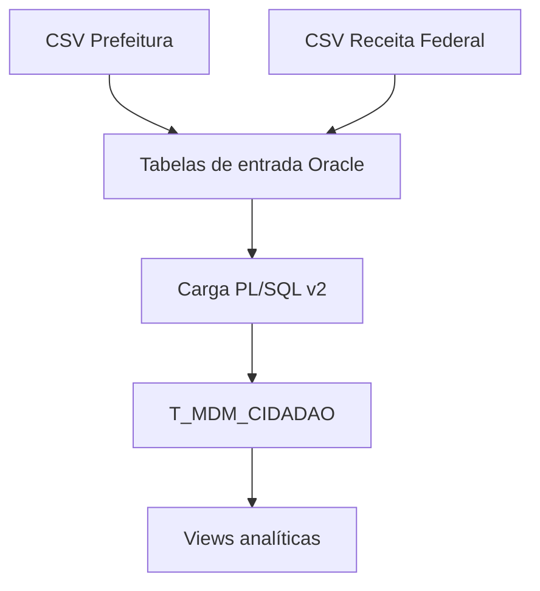

# Cidade Alfa — MDM de Cidadãos

Projeto acadêmico desenvolvido em grupo na Fase 6 do PBL da FIAP, com foco em engenharia de dados. Integra cadastros da Prefeitura e da Receita Federal em uma tabela mestre de cidadãos, aplicando regras de padronização, consolidação e registro de divergências.

O desenvolvimento utiliza VS Code com a extensão Oracle SQL Developer; o processamento ocorre no banco Oracle. Este projeto integra o portfólio de [Ricardo Gnan Junior](https://github.com/Gnanjr-wq).

## Problema e solução

As duas fontes apresentam formatos diferentes de datas e sexo, nomes divergentes e valores ausentes ou inválidos. A rotina PL/SQL relaciona os cidadãos pelo CPF, transforma os atributos e grava o registro consolidado em `T_MDM_CIDADAO`. As inconsistências permanecem rastreáveis por `FL_DIVERGENCIA` e `DS_DIVERGENCIA`.

O fluxo compreende importação manual dos CSVs para tabelas de entrada, transformação em lote e consulta por views. Não há agendamento ou orquestrador implementado.

## Resultados observados

Resultados conferidos no ambiente acadêmico em 08/10/2026, com 100 registros em cada fonte e correspondência dos 100 CPFs entre elas.

| Indicador | Resultado |
|---|---:|
| Cidadãos consolidados / CPFs distintos | 100 / 100 |
| Sem divergências / com divergências | 67 / 33 |
| Idade e faixa etária preenchidas | 94 |
| Adultos / idosos / sem classificação | 57 / 37 / 6 |
| Sexo feminino / masculino / não informado | 55 / 44 / 1 |
| Escolaridade preenchida | 100 |
| Combinações na view de faixa etária e escolaridade | 16 |
| Soma das quantidades da view | 100 |

Os seis registros sem classificação etária correspondem a três datas inválidas na Receita e três datas ausentes na Prefeitura. Divergências de qualidade não são erros de execução.

A execução da v2 sobre a base previamente carregada apresentou 100 lidos, zero inseridos, 100 atualizados e zero erros. Após a reexecução informada, foram conferidos 100 registros, 100 CPFs distintos e 100 IDs distintos. Essa validação comprova ausência de duplicação nessa base, não uma validação de todos os cenários possíveis.

As idades e faixas são calculadas com a data do banco no momento da carga; os resultados podem mudar em execuções futuras.

## Regras implementadas e decisões

- **CPF:** remoção de pontos e hífen para a chave numérica; preservação do CPF com máscara para exibição. Não há validação dos dígitos verificadores.
- **Nome:** aplicação de `UPPER` e `TRIM`. Receita como origem inicial; Prefeitura quando os nomes divergem ou o nome da Receita está ausente. A documentação acadêmica apresenta ambiguidade de prioridade; adotou-se a orientação específica para o caso de divergência.
- **Nascimento:** Receita em `DD/MM/YYYY` e Prefeitura em `MM/DD/YYYY`. Ausência em qualquer origem, falha de conversão ou diferença entre datas resulta em nascimento consolidado nulo e registro de divergência.
- **Idade:** `TRUNC(MONTHS_BETWEEN(TRUNC(SYSDATE), DT_NASCIMENTO) / 12)`, apenas para nascimento não futuro e idade entre 0 e 130. Caso contrário, idade e faixa ficam nulas.
- **Faixa etária:** 0–2 BEBE; 3–11 CRIANCA; 12–17 ADOLESCENTE; 18–59 ADULTO; 60–130 IDOSO. A constraint inclui BEBE.
- **Sexo:** Receita M/F e Prefeitura 1/2 são convertidos em descrições. Na interpretação adotada, ausência ou domínio inválido em qualquer fonte produz NAO_INFORMADO. Quando ambos são válidos e diferentes, mantém-se a Receita e registra-se a divergência.
- **Estado civil:** S/C/D/V/U convertidos em descrições; demais valores geram NAO_INFORMADO e divergência.
- **Escolaridade:** remoção do prefixo numérico seguido de hífen, aplicação de `UPPER` e `TRIM`; descrições como SUPERIOR_INCOMPLETO são preservadas. Ausência permanece nula.
- **Gravação:** tentativa de INSERT; em duplicidade de chave, UPDATE pelo CPF, com conferência de uma linha atualizada. Falhas de gravação propagam o erro e provocam ROLLBACK; sucesso conclui com COMMIT.

A idade fica armazenada até a próxima carga. `DT_CARGA` é atualizado a cada processamento. A sequence é consumida mesmo nas tentativas que terminam em UPDATE, podendo apresentar saltos; o ID existente não é alterado pelo UPDATE.

## Pré-requisitos e dados de entrada

- Acesso a um banco Oracle com suporte às funções utilizadas, incluindo `VALIDATE_CONVERSION` nos diagnósticos.
- Permissão para criar tabelas, sequence e views no schema do projeto.
- Cliente capaz de executar scripts SQL e blocos PL/SQL, como a extensão Oracle utilizada no VS Code.
- Arquivos acadêmicos `SRC_PREFEITURA_CIDADAO.CSV` e `SRC_RECEITA_FEDERAL.CSV`, obtidos com o material da disciplina.

Os dois CSVs estão disponíveis na pasta `dados/` e contêm dados fictícios fornecidos para o exercício acadêmico. Os arquivos originais foram preservados, incluindo valores ausentes, formatos diferentes e datas inválidas, para demonstrar os tratamentos de qualidade implementados.

- [Cadastro da Prefeitura](dados/SRC_PREFEITURA_CIDADAO.CSV)
- [Cadastro da Receita Federal](dados/SRC_RECEITA_FEDERAL.CSV)

Na importação, utilizar delimitador `;`, codificação UTF-8, cabeçalho e correspondência das colunas por nome. Importar nas tabelas existentes, mantendo datas e demais valores como texto.
## Ordem de execução em um schema novo

| Etapa | Arquivo ou ação | Objetivo |
|---|---|---|
| 1 | [verificacao_ambiente.sql](sql/verificacao_ambiente.sql) | Conferir conexão e data do banco |
| 2 | [t_strage.sql](sql/t_strage.sql) | Criar as duas tabelas de entrada |
| 3 | Importar os dois CSVs nas tabelas correspondentes | Carregar as fontes sem limpeza prévia |
| 4 | [dado_origens.sql](sql/dado_origens.sql) | Conferir volumes, CPFs, correspondências e domínios |
| 5 | [cria_mdm_cidadao.sql](sql/cria_mdm_cidadao.sql) | Criar tabela mestre, constraints e sequence |
| 6 | [validacao_objetos.sql](sql/validacao_objetos.sql) | Inspecionar fontes e objetos da MDM |
| 7 | [script_carrega_dados_T_MDM_CIDADAO_v2.sql](sql/script_carrega_dados_T_MDM_CIDADAO_v2.sql) | Executar a carga consolidada |
| 8 | [validacao_mdm_v2.sql](sql/validacao_mdm_v2.sql) | Conferir preenchimento, distribuições e divergências |
| 9 | [vie_stado_civil.sql](sql/vie_stado_civil.sql) | Criar e consultar a view de estado civil |
| 10 | [cria_view_qtd_total_fx_etaria_escolaridade.sql](sql/cria_view_qtd_total_fx_etaria_escolaridade.sql) | Criar e validar a view final |

Execute o bloco v2 completo, incluindo `DECLARE`, `BEGIN`, `END;` e a barra `/` final, com a opção de execução de script. A execução parcial a partir do cursor causa erros de declaração.

Em uma MDM vazia, a carga da base acadêmica deve inserir 100 cidadãos. Sobre a base já carregada, deve atualizar 100, sem inserir novos cidadãos. Para reprocessar, execute somente a v2 e as consultas de validação; não repita os scripts de criação.

**Criação e exclusão:** os dois DROP de `cria_mdm_cidadao.sql` estão comentados na cópia preparada para o portfólio. Descomentá-los apaga a tabela e reinicia a sequence por recriação. Os CREATE não são idempotentes: se os objetos existem, não execute novamente a instalação. Execute a carga em sessão sem outras alterações pendentes, pois COMMIT e ROLLBACK afetam a transação da sessão.

## Arquivos auxiliares e histórico

| Arquivo | Papel |
|---|---|
| `script_carrega_dados_T_MDM_CIDADAO_v1.sql` | Exercício inicial, preservado como histórico; não é requisito para executar a v2 |
| `validacao_mdm.sql` | Consultas iniciais de contagem e preenchimento, com consultas equivalentes repetidas |
| `mdm_cidadao.sql` | Somente exemplos de DROP comentados; não cria nem carrega objetos |

Os nomes originais dos scripts auxiliares foram mantidos. A carga v2 substitui a v1 no fluxo principal.

## Limites conhecidos

A rotina foi validada com a base fornecida, na qual cada CPF possui correspondência única nas duas fontes. A busca na Receita usa igualdade textual do CPF e `ROWNUM = 1`: não resolve duplicidades nessa origem. Ausência de correspondência na Receita interrompe a carga. O diagnóstico prévio é necessário ao usar outra base.

O diagnóstico de datas usa máscaras estritas com `FX`; a conversão na carga utiliza `TO_DATE` sem `FX`. Os formatos esperados foram conferidos na base acadêmica, mas o código não garante rejeição de toda variação textual possível.

Não foram executados testes específicos de todos os limites etários, concorrência, volume elevado ou cenários de falha. O projeto não implementa histórico de alterações por cidadão nem log persistente das execuções; o relatório é exibido via `DBMS_OUTPUT`.

## Competências demonstradas

SQL e PL/SQL, cursores e records, transformação em lote, integração de fontes, constraints, tratamento de exceções, controle transacional, diagnóstico de qualidade e views analíticas.

## Equipe

Claudia Obi, Diego Barreto Carvalho, Guilherme Martins, Ricardo Gnan Junior e Walleska Contarini.
## Evidências

Resultados e capturas foram conferidos durante o desenvolvimento. As imagens ainda não estão incluídas neste pacote. A documentação registra os resultados observados; a publicação das capturas pode complementar a demonstração.
